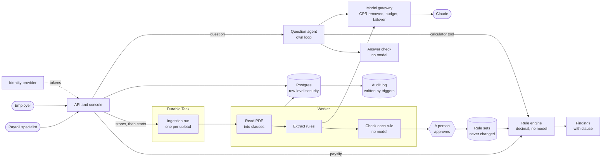

<p align="center">
  <picture>
    <source media="(prefers-color-scheme: dark)" srcset="assets/logo-dark.svg">
    
  </picture>
</p>

<h1 align="center">Overens</h1>

<p align="center">
  <b>An AI agent that checks payslips against Danish collective agreements.</b><br>
  The model reads and words things. Code decides and calculates. A person approves every rule.
</p>

<p align="center">
  <a href="https://github.com/devjoinedthechat/Overens/actions/workflows/ci.yml"></a>
  <a href="./LICENSE"></a>
  
  
</p>

<p align="center">
  <a href="#walkthrough">Walkthrough</a> ·
  <a href="#results">Results</a> ·
  <a href="#what-it-proves">What it proves</a> ·
  <a href="#quick-start">Quick start</a> ·
  <a href="#how-an-agreement-becomes-rules">How it works</a> ·
  <a href="#design-decisions">Design decisions</a>
</p>

A collective agreement (*overenskomst*) says what people must be paid: minimum wages by seniority, overtime, evening and night supplements, pension, holiday allowance. Overens reads an agreement's PDF into typed rules, has a payroll specialist approve them, and then checks payslips against them and answers questions about the agreement with the clause cited.

*Overens* is Danish for "in agreement". The repo is organised around one question: what happens when the model is wrong? A model reads the agreement and words the findings. It never calculates, never decides whether a payslip is right, and never publishes a rule. Every property claimed below has a test that tries to break it.

## Walkthrough


The system running on one machine with Claude as the model. Every picture is the real console. On the left of each rule are its values; on the right, in print, the clauses it was read from, with the quoted sentence marked. The explanation and the answer in the last two pictures are the model's, after passing the checks.

## Results

Every document is synthetic, so the right answer is known before any model reads it. All but eight are generated from a rule set; the eight were written by hand. No real agreement has been measured.

| What | Claude Sonnet | Claude Haiku |
| --- | --- | --- |
| Rules read out of ten agreements | 121 of 121 | 121 of 121 |
| Rules read out of six long agreements | 79 of 79 | 79 of 79 |
| Wrong rules the model-free checks missed | 0 | 0 |
| Payslips checked correctly, all sixteen | 1,152 of 1,152 | 1,152 of 1,152 |
| Asked again: passes in which all 200 rules were found | 3 of 3 | 5 of 5 |
| Questions answered correctly, of 48 | 48 | 48 |
| Wrong answers shown | 0 | 0 |
| Rules changed by five planted instructions | 0 | 0 |
| Cost to read one agreement, short and long | $0.08 and $0.28 | $0.005 and $0.015 |
| **Rules read out of four agreements nobody here had seen** | **40 of 51 (65–88 pct.)** | **30 of 51 (45–71 pct.)** |
| **Wrong rules the checks missed, on those four** | **7** | **2** |
| **Payslips judged wrongly, on those four** | **36 of 288** | **36 of 288** |

The first nine rows are on documents from the generator the prompt grew up beside. The last three are not, and they are the ones to read.

The numbers are after fixes. On first contact with documents the prompt had not seen, a wage given as "raised by 5,00 kr." broke extraction, Sonnet silently chose between two contradicting clauses, and Haiku searched thirteen times for something the agreement does not cover. The long set added two more: a pension share stated as "half of the employer's contribution", which printed no figure to check, and a mistake in the test data itself. All are in the report.

Extraction prompt `2026-11-22.1` was recorded through Claude Code's print mode, with the same request the system sends. Costs were measured through the API on the prompt before it.

### The checks, on wrong answers

Models that make no mistakes say little about the checks that are there to catch them. So 2,366 mistakes of 48 kinds were planted in the recorded answers, one at a time, and extraction was run on each.

| Planted mistake | Stopped | Reported | Silent |
| --- | --- | --- | --- |
| A figure the agreement does not print, or one step off | 697 of 697 | 0 | 0 |
| The wrong days, or a spoiled quote or clause | 929 of 929 | 0 | 0 |
| The agreement's own figure in the wrong place | 278 of 365 | 0 | 87 |
| A part of a rule, or a whole rule, left out | 0 of 375 | 200 | 175 |

A stopped rule cannot be published until a person acts. What passes in silence is a rule made only of figures printed where it says: two percentages in one sentence exchanged, or a weekday left out. The first run of this study stopped 1,601; it found three faults in the checks, which stop 1,904 since the fixes. The [study](docs/eval-report/README.md#the-checks-measured-on-wrong-answers) has every kind of mistake and what still gets through.

### Off the generator's phrasings

Eight agreements were written by hand, in two batches, by writers shown nothing of the generator, the prompt or the checks.

- **The first batch broke the prompt.** It stated figures in three ways the prompt had no field for: a step per seniority band, a share of a total, a change in percentage points. The prompt was changed to take them, and both models then read all 48 rules.
- **The second batch broke it again.** It was written while the fix was made, and read once to measure it. Its figures were stated in other ways: a supplement as 160 pct. of another, a share as what is left of a total, a holiday allowance as the sum of two parts.
- **Wrong rules passed, and payslips were judged on them.** Sonnet reported a seniority supplement as "added to the band before" where the agreement adds it to the base: every figure printed, the sum wrong. Both models took one part of a two-part holiday allowance as the whole, and 36 payslips were judged on it.

The fields that let the model hand a sum to the code also let it hand over the wrong sum, and the checks cannot see that. So every agreement is read a second time, by the other model, and a rule the two readings differ on goes to a person. With Sonnet reading and Haiku second, four of Sonnet's seven wrong rules are caught, and no correct rule of the 200 generated ones is flagged. The three that pass are mistakes both models make ([decision 12](docs/adr/0012-a-second-reading.md)).

The answer keys of all eight were checked by a third reader that saw only the agreements: it read the same 99 rules. Ranges are 95 pct. intervals. Recorded through Claude Code's print mode; [in the report](docs/eval-report/README.md#agreements-the-generator-did-not-write) with the first-read figures.

The [eval report](docs/eval-report/README.md) has each failure, its fix, and what the numbers do not show. A test fails if the published results differ from what the recorded answers give.

## Quick start

It needs the .NET 10 SDK and Docker. The browser part of the smoke test also needs Google Chrome.

```sh
git clone https://github.com/devjoinedthechat/Overens && cd Overens
scripts/check.sh      # secrets scan, build, format check, every test
scripts/smoke.sh      # the whole system from nothing, one agreement from upload to checked payslips
scripts/coverage.sh   # the tests again, counting the lines they run
scripts/mutation.sh   # the rule engine changed one small way at a time, against its tests
git config core.hooksPath .githooks   # once per clone: the secrets scan runs before every commit
```

The same smoke test runs against the container images the system is deployed as:

```sh
scripts/containers.sh build
STACK=containers scripts/smoke.sh
```

No model key is needed for either. Tests use stand-in models, and the system replays the answers recorded for the corpus agreements.

### Run the whole system locally

```sh
dotnet run --project src/AppHost
```

| Service | Address | What it is |
| --- | --- | --- |
| Console | `http://localhost:5058/app/` | Upload and review as a specialist; check pay and ask as an employer |
| API | `http://localhost:5058` | The same, for programs. Contract at `/openapi/v1.json`, probes at `/health` and `/alive` |
| Keycloak | `http://localhost:8081` | Sign-in. Realm `overens`, admin `admin` / `admin` |
| Scheduler | `http://localhost:8092` | Each run, step by step |
| Dashboard | `http://localhost:15034` | Logs and traces of every service |

Local accounts, all with the password `local-demo-password`:

| User | Company | Role |
| --- | --- | --- |
| `anna` | `tvaerhavn-loen` | Specialist: uploads, reviews, approves |
| `bo` | `elmekaer-regnskab` | Specialist at another company |
| `eva` | `tvaerhavn-loen` | Employer: checks pay and asks questions |
| `erik` | `tvaerhavn-loen` | None: signed in, and let in nowhere |

Upload `data/synthetic/hard-2026/agreement.pdf` as `anna`. Check a case from `data/synthetic/hard-2026/pay.json` as `eva`; `pay-answers.json` says which are wrong and how.

With `ANTHROPIC_API_KEY` set, Claude is called: findings are worded by a model and questions are answered. Each company has a daily budget for that, and each process a cap behind it. Without a key, findings get fixed wording and questions are refused.

### Evals

```sh
dotnet run --project evals/Runner                    # extraction on sixteen agreements
dotnet run --project evals/Runner -- --questions     # 48 questions with known answers
dotnet run --project evals/Runner -- --attacks       # planted instructions and a contradiction
dotnet run --project evals/Runner -- --explain       # how often a model's wording passes the guard
dotnet run --project evals/Runner -- --planted       # 2,366 mistakes planted in correct answers, and what the checks do
dotnet run --project evals/Runner -- --independent   # eight agreements the generator did not write
dotnet run --project evals/Runner -- --variance 3    # the same extraction, asked three times
dotnet run --project evals/Runner -- --second-reader # each rule held against the other model's reading
dotnet run --project evals/Runner -- --review-study  # a page of rule cards for a person to review, and its key
```

Each replays recorded answers and spends nothing. Add `--model claude-haiku-5-5` for the other model, and `--record --cap 2` with a key to call the model for anything not yet recorded. The last two can also be recorded with no key, through Claude Code: `--record --via claude-code`.

## How an agreement becomes rules

1. **Stored.** The PDF is kept under the hash of its bytes and never changed, so the words a rule quotes can always be produced.
2. **Read, with no model.** Text from the letters and their positions; tables from their ruled borders. Front page, table of contents, running titles and page numbers are dropped. Clauses split by a page break are joined. Every clause gets an id such as `§ 5, stk. 2`.
3. **Extracted.** One request per kind of rule, each with a strict schema. The agreement is passed as data. The model returns typed rules, each naming its clause and quoting a sentence from it.
4. **Checked, with no model.** The clause exists; the quote stands in it word for word; every number and date is printed where the rule says; a figure in a table stands under the rule's date and in its row; values are in range. Missing kinds, uncovered days and conflicting rules are reported for the run.
5. **Read again, by the other model.** A rule the second reading states differently on any day it applies is flagged.
6. **Reviewed.** A specialist sees each rule beside its clause with the quote marked, and what publishing would change against the rules already published. They approve or reject each rule, then the run.
7. **Published.** The database publishes the approved rules as the agreement's next version, and only if an approval is on record. A version is never edited; a later one takes over from the day it starts.

A payslip is then checked by arithmetic: the engine works out what the period should have paid, minute by minute, and reports every line that differs with the rule and clause behind it.



## What it proves

Each row is a property, the attack on it, and the file the test is in. Where a control was added, a bug was planted to confirm the test fails without it.

Two figures say how much the tests would notice, and CI holds a floor under each:

| Measure | Figure | CI fails below |
| --- | --- | --- |
| Lines of the production code that a test runs | 95.5 pct. | 94 |
| Changes to the rule engine's arithmetic that a test notices | 96.4 pct. of 386 | 93 |

The second is mutation testing: a `<` is made a `<=`, a `+` a `-`, one change at a time, and the tests are run against each. Its first run scored 79.7 pct. What it found missing were the edges: the last minute of a time window, a wage exactly at the minimum, a line that pays too much.

<details>
<summary><b>The model does not decide</b>: 13 properties</summary>

| Property | How the test tries to break it | Test |
| --- | --- | --- |
| The model never calculates | A stand-in model adds up an increase itself; the sums are printed nowhere and are refused. Reported as an increase, code adds it | [ExtractionTests](tests/Ingestion.Tests/ExtractionTests.cs) |
| Money is never a float | Reflection over the rules assembly for any `float` or `double` | [NoFloatingPointTests](tests/Rules.Tests/NoFloatingPointTests.cs) |
| Every rule quotes its clause | A reworded quote, a clause that does not exist | [ExtractionTests](tests/Ingestion.Tests/ExtractionTests.cs) |
| Every number is the agreement's | The pension total read as the employer's share; a rate off by one krone; a start date printed nowhere | [ExtractionTests](tests/Ingestion.Tests/ExtractionTests.cs) |
| A figure stands where the agreement puts it | Next year's rate, another band's rate, a window back to front; every figure printed in the cited clause | [ExtractionTests](tests/Ingestion.Tests/ExtractionTests.cs) |
| A missing rule is reported | A stand-in returns only the first year; nothing is flagged on any rule, and the gap is reported | [ExtractionTests](tests/Ingestion.Tests/ExtractionTests.cs) |
| A contradiction is put to a person | Two clauses give different figures; both are proposed, the conflict names both clauses, and approving both is refused | [ApiTests](tests/Api.Tests/ApiTests.cs) |
| An explanation uses only the finding's numbers | A percentage the model worked out; a deadline it invented; "too much" said of a shortfall | [FindingExplainerTests](tests/Agent.Tests/FindingExplainerTests.cs) |
| An answer rests on the agreement | A sum the model made; a reworded quote; a number from a clause it did not cite; a number written as a word | [QuestionAgentTests](tests/Agent.Tests/QuestionAgentTests.cs) |
| Money in an answer is money a person approved | A planted clause, quoted word for word, that states a wage; its figure is not repeated | [HardeningTests](tests/Agent.Tests/HardeningTests.cs) |
| Half an answer is not an answer | A model that runs out of room; the run fails at once, is not asked again, and says why | [HardeningTests](tests/Ingestion.Tests/HardeningTests.cs) |
| What the agreement does not say is not answered | Twelve unanswerable questions per model; the fixed sentence is the only correct outcome | [GateTests](tests/Evals.Tests/GateTests.cs) |

</details>

<details>
<summary><b>A person publishes</b>: 7 properties</summary>

| Property | How the test tries to break it | Test |
| --- | --- | --- |
| Nothing is published without a person's approval | The worker calls publish with no approval; tries to write an approval, a decision and a rule set directly | [SchemaTests](tests/Data.Tests/SchemaTests.cs) |
| The API cannot publish | The API's database role calls the publish function | [SchemaTests](tests/Data.Tests/SchemaTests.cs) |
| A flagged rule cannot be approved | Through the API, and directly in the database | [SchemaTests](tests/Data.Tests/SchemaTests.cs) |
| What was approved is what is published | A decision changed after the approval and before publication | [SchemaTests](tests/Data.Tests/SchemaTests.cs) |
| A published rule set cannot change | Update, delete and truncate, as each role and as the database's owner | [SchemaTests](tests/Data.Tests/SchemaTests.cs) |
| A payslip is checked against the rules of its own date | A renewal from 2029; payslips on both sides of it | [ApiTests](tests/Api.Tests/ApiTests.cs) |

</details>

<details>
<summary><b>Isolation and privacy</b>: 9 properties</summary>

| Property | How the test tries to break it | Test |
| --- | --- | --- |
| One company cannot see another's data | Another company's token on every route; another tenant's scope on every table | [ApiTests](tests/Api.Tests/ApiTests.cs) |
| A token is checked, not trusted | Wrong key, expired, wrong audience, no role, no company | [ApiTests](tests/Api.Tests/ApiTests.cs) |
| A company's token comes from its own directory | With an issuer per company, a token from one directory that names another company | [ApiTests](tests/Api.Tests/ApiTests.cs) |
| An employer cannot do a specialist's work | Upload and rule sets with an employer's token | [ApiTests](tests/Api.Tests/ApiTests.cs) |
| A CPR number never reaches a model | In a question and in a tool result; removed at the layer next to the provider | [GatewayTests](tests/Gateway.Tests/GatewayTests.cs) |
| Pay data is not kept | Thirty payslips checked; the audit log holds counts and no employee id | [ApiTests](tests/Api.Tests/ApiTests.cs) |
| Telemetry carries no content | Every attribute of every span of a run searched for the agreement's words | [PipelineTests](tests/Worker.Tests/PipelineTests.cs) |
| A company can be erased, by the owner only | Each service role tries; the owner tries another company's rows | [AuditTests](tests/Data.Tests/AuditTests.cs) |

</details>

<details>
<summary><b>Hostile input</b>: 5 properties</summary>

| Property | How the test tries to break it | Test |
| --- | --- | --- |
| Text in a document cannot give orders | Five passages addressed to AI systems, one inside the wage clause, one dressed as a protocol; both real models | [GateTests](tests/Evals.Tests/GateTests.cs) |
| A damaged file does not reach the model | A PDF cut short, scrambled, or only a header | [PipelineTests](tests/Worker.Tests/PipelineTests.cs) |
| Markup is shown as text | Typed into the console; any script or console error fails the browser check | [UiCheck](tools/UiCheck/Program.cs) |
| The console loads only its own code | The content policy is read back and may not contain `unsafe` | [ApiTests](tests/Api.Tests/ApiTests.cs) |

</details>

<details>
<summary><b>Operations</b>: 12 properties</summary>

| Property | How the test tries to break it | Test |
| --- | --- | --- |
| A run survives its worker dying | The worker is stopped while a run waits; the review is done with nothing running; a second worker finishes without reading again | [PipelineTests](tests/Worker.Tests/PipelineTests.cs) |
| An upload is never lost | The scheduler is unreachable at upload; the worker finds the run and starts it once | [PipelineTests](tests/Worker.Tests/PipelineTests.cs) |
| A model that is down is replaced | The asked-for model fails; the other answers, and the run records which | [GatewayTests](tests/Gateway.Tests/GatewayTests.cs) |
| One company cannot spend without limit | A daily budget of five cents; the second agreement is refused at once, and a failed attempt counts too | [PipelineTests](tests/Worker.Tests/PipelineTests.cs) |
| Calls at the same moment cannot pass the cap together | Two calls start together under a cap one of them fills; the second is refused | [HardeningTests](tests/Gateway.Tests/HardeningTests.cs) |
| A slow model is not waited for | A model that never answers; the other one does, inside the time limit | [HardeningTests](tests/Gateway.Tests/HardeningTests.cs) |
| Bad input is the caller's mistake, not a crash | Seven malformed payslips, overlapping shifts, work before the hiring date; each is a 400 with a reason | [ApiTests](tests/Api.Tests/ApiTests.cs) |
| A line with no approved rule is not called wrong | A correct payslip checked without the savings rule; the line is reported as not checked | [ApiTests](tests/Api.Tests/ApiTests.cs) |
| A run whose pipeline is gone does not stay open | A run handed to a pipeline the scheduler never had is ended as failed; one waiting for review is left alone | [PipelineTests](tests/Worker.Tests/PipelineTests.cs) |
| Every change is logged, and the log cannot be edited | Each role tries to write, change and empty it; the owner's edit breaks that company's hash chain; a rolled-back write does not | [AuditTests](tests/Data.Tests/AuditTests.cs) |
| An agent cannot run forever | A stand-in that only ever searches | [QuestionAgentTests](tests/Agent.Tests/QuestionAgentTests.cs) |

</details>

## Stack

| Layer | Choice | What it does here |
| --- | --- | --- |
| Language | C# on .NET 10, warnings as errors | One language across services, engine, evals and tests |
| Model | Claude Sonnet and Haiku, Anthropic C# SDK | Reads agreements, words findings, answers questions |
| Model seam | `Microsoft.Extensions.AI` | Redaction, failover, time limits, budget and replay are layers on one interface |
| Agent loop | Own, about a hundred lines | Five read-only tools; the answer is checked before it is shown |
| Rules | Typed records and an engine on `decimal` | Every sum, with no model |
| Durable work | Durable Task Scheduler | One orchestration per upload; waits days for a reviewer; survives a dead worker |
| Data | PostgreSQL, plain-SQL schema, EF Core for access | Row-level security per company, three roles, immutable tables |
| Identity | OpenID Connect; Keycloak locally, Microsoft Entra ID when deployed | Roles and company from the token |
| PDF | PdfPig to read, MigraDoc to generate | Clauses from layout; tables from their ruled borders |
| Telemetry | OpenTelemetry | Spans whose attributes come from a fixed list |
| Local | .NET Aspire | The whole system from one command |
| Tests | xUnit, Testcontainers, CsCheck, Playwright, Stryker | Real Postgres and scheduler; property tests; a real browser; mutation testing of the arithmetic |

## Test material

| What | Where |
| --- | --- |
| Eighteen agreements as PDF, text and structure, with the rules each states. Six are about 24 pages long | `data/synthetic` |
| Six months of timesheets and payslips for each, with nine kinds of seeded payroll mistake and the answers | `data/synthetic/*/pay.json` |
| Eight agreements written by hand without sight of the generator, with the rules each states. The second four were read once, to measure a fix made on the first | `data/independent`, `data/unseen` |
| The generators | `src/Synthetic` |
| Recorded model answers | `evals/recordings` |

The corpus is generated, never edited by hand: `dotnet run --project tools/Corpus` writes it, and a test fails if the committed files differ. The organisations and agreement names are invented, and each PDF says so on its front page. The PDFs use Liberation Serif, under the SIL Open Font License.

## Repository layout

| Path | What is there |
| --- | --- |
| `src/Rules` | Rule records, the pay engine, the validator, versions and comparison. No dependencies, no model |
| `src/Documents` | The structure of an agreement: sections, clauses, text and tables |
| `src/Ingestion` | PDF to clauses, the extraction prompt and schemas, the checks, the pipeline's steps |
| `src/Agent` | The finding explainer and its guard; the question agent, its tools and the answer check |
| `src/Gateway` | Model access: redaction, failover, budget, usage, replay, telemetry |
| `src/Data` | The schema in SQL, the migrator, tenant-scoped access |
| `src/Worker` | The durable orchestration and the starter for runs that were never dispatched |
| `src/Api` | The API and the console |
| `src/AppHost` | The local system: Postgres, scheduler, Keycloak, worker, API |
| `src/Synthetic` | Generators for agreements, PDFs and pay data |
| `evals` | The eval runner and the recorded answers |
| `tests` | One project per source project |
| `tools` | Corpus writer, migrator and admin commands, the browser check and walkthrough recorder |
| `infra` | The Azure infrastructure file, the same system as containers with local stand-ins, the demo sign-in realm |
| `docs` | Decision records, eval report, threat model, cut list, a note on the EU AI Act |

## Design decisions

1. [The model never calculates](docs/adr/0001-the-model-never-calculates.md)
2. [The rules come first and the documents are written from them](docs/adr/0002-rules-before-documents.md)
3. [A person publishes, and the database insists](docs/adr/0003-a-person-publishes.md)
4. [Every proposed rule is checked against the agreement with no model](docs/adr/0004-grounding-without-a-model.md)
5. [Durable Task for the pipeline](docs/adr/0005-durable-task.md)
6. [Own agent loop instead of a framework](docs/adr/0006-own-agent-loop.md)
7. [An answer is shown only if it can be checked](docs/adr/0007-answers-must-be-checkable.md)
8. [Rule sets are never changed, and the newest version takes over by date](docs/adr/0008-immutable-versions.md)
9. [Pay data is checked and not kept](docs/adr/0009-pay-data-is-not-kept.md)
10. [The audit log is written by the database, and telemetry carries no content](docs/adr/0010-logged-by-the-database.md)
11. [One model provider, and no real agreements](docs/adr/0011-one-provider.md)
12. [Every agreement is read twice, by two models](docs/adr/0012-a-second-reading.md)

See also [Running on Azure](docs/azure.md), the [threat model](docs/threat-model.md), [what was left out, and why](docs/cut-list.md), and [the EU AI Act and this system](docs/ai-act.md). To report a vulnerability, see [SECURITY.md](SECURITY.md); to change something, [CONTRIBUTING.md](CONTRIBUTING.md).

## Scope

- **Synthetic documents only.** A published agreement is its parties' copyrighted text. None is downloaded, read or sent to a model, so nothing here is evidence about real agreements.
- **A value must be printed, or be one of two things code can work out.** An increase on an earlier rate and a share stated as a part of another figure are reported by the model as printed and worked out by code. Anything else a model derived is flagged.
- **Six kinds of rule.** Minimum wage, overtime, inconvenient hours, pension, holiday allowance and special savings. A real agreement says more about pay than that.
- **One model provider.** Failover is between Claude models, which covers a model short of capacity and not the provider being down.
- **Not yet run on Azure.** The deployment is defined and checked without an account: the infrastructure file compiles, the images build, and the system passes its smoke test from those images. See [Running on Azure](docs/azure.md). On one machine it runs with development settings: plain HTTP, fixed demo passwords and a default Keycloak admin.
- **A reviewer approves or rejects.** Editing a proposed rule is not built.
- **The reviewer is not measured.** The reviewer is the last guard against a wrong rule that every check passes, and nobody has measured how good a guard a person is. A study for people to take is built (`dotnet run --project evals/Runner -- --review-study`): 36 rule cards beside their clauses, 12 of them wrong in ways that pass every check, and a scorer. No one has taken it yet.
- **A small console.** One page, in English, written without a framework or a build step. Agreements, findings and answers are in Danish, and the agreement's own words are set apart from the interface as print.

## Licence

[MIT](LICENSE)
